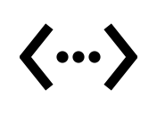

# WiredStatus

A small, native Ethernet indicator for the macOS menu bar. Built from scratch in Swift/AppKit and C, using only macOS APIs. No packages to install, accounts, analytics, servers, packet capture, or automatic speed tests.

## What you see



Native vector preview of the menu-bar mark.

- Apple's classic `<•••>` Ethernet mark in the menu bar, drawn as a native template. A slash means no confirmed cable link; an extra dot underneath means a cable is linked but the selected adapter is not the default network route.
- Negotiated link speed and duplex, including 1, 2.5, 5, and 10 Gbps Ethernet.
- Live receive/send rates and a 60-second graph, sampled only while the panel is open.
- Separate physical-link and default-route status for IPv4 and IPv6. A VPN or Wi-Fi default route is named rather than silently called Ethernet.
- The selected Ethernet adapter's MAC address and local IP/router addresses, hidden by default, with selectable values for copying.
- A native optional Open at login setting and a picker for adapters with a cable link or default route. Unused interfaces are hidden; one disconnected adapter remains available when none are in use.

Link speed is the Ethernet connection's capacity, **not** an internet speed test. Live rates count all traffic on the selected adapter, including local-network traffic. The graph auto-scales; it isn't a percentage of the link's capacity. Interface errors are cumulative driver counters since reset and aren't an end-to-end packet-loss measurement.

The picker uses connection metadata, so an idle adapter stays visible. It switches away from an unavailable saved selection when another adapter is in use, and restores a preferred adapter when it reconnects. If the last adapter disconnects, its state stays visible; if it is removed, selection safely falls back to an available interface. Metadata and MAC addresses are read only when configuration refreshes, not during the one-second traffic samples.

## Screenshots

Captured from version 1.0.2 running on a real Mac. Only its connected adapter appears in the picker. MAC, IP, and router addresses are hidden using the privacy setting.


## Build and run

Requires macOS 13 or newer and Xcode or its command-line tools with Swift 5.10 or newer. Build on either an Apple Silicon or Intel Mac; the result targets the build machine's architecture.

```sh
./scripts/build.sh
open dist/WiredStatus.app
```

The release script applies a local ad-hoc signature. No signing keys or Apple developer membership are needed to build locally. It isn't a notarized public download. On another Mac, build from this source using the instructions above.

To install the locally built app:

```sh
mkdir -p "$HOME/Applications"
ditto dist/WiredStatus.app "$HOME/Applications/WiredStatus.app"
open "$HOME/Applications/WiredStatus.app"
```

The app stays out of the Dock. Click its menu-bar icon to open the panel. Open at login is opt-in. Quit from the panel before rebuilding or replacing an installed copy.

To put the icon where Wi-Fi used to be, hold **⌘ Command** and drag it along the menu bar to that spot. WiredStatus sets a stable NSStatusItem autosave name so macOS remembers the position after relaunch. It is its own status item; it does not replace Apple's Wi-Fi control or take over Control Centre. [Apple's menu-bar guide](https://support.apple.com/en-hk/guide/mac-help/-mchlp1446/mac)

A locally built Apple Silicon app is also attached to the [v1.0.2 release](https://github.com/ReinoutPaardekooper/wired-status/releases/tag/v1.0.2), with its SHA-256 checksum. The source build remains the inspectable way to reproduce it. No automatic updater contacts GitHub.

Release packages omit filesystem extended attributes, quarantine metadata, and build-machine toolchain search paths. To verify a downloaded archive, put it beside the checksum file and run `shasum -a 256 -c WiredStatus-arm64.sha256`.

## Verify

```sh
swift test
dist/WiredStatus.app/Contents/MacOS/WiredStatus --diagnostics
dist/WiredStatus.app/Contents/MacOS/WiredStatus --benchmark
```

`--diagnostics` prints current local interface data, including MAC and IP addresses, to the terminal; keep those outputs private. Neither CLI mode contacts a server. `--benchmark` repeatedly reads existing kernel counters; it measures the cost of the app's sampling API, not network speed.

See [performance measurements and method](docs/performance.md) and [implementation decisions](docs/design.md). Generated builds and local measurement data are excluded from Git. There are no external dependencies, so no dependency lockfile is required.

## Privacy and practical limits

Network configuration, physical link state, and counters are read locally. The only persistent settings are the selected adapter and address-visibility preference in macOS UserDefaults; Open at login uses Apple's ServiceManagement API. No traffic history is saved to disk. The tiny graph is bounded to 60 in-memory samples and clears when the panel closes.

The indicator does not prove that the router or internet is reachable. Unknown or unsupported link modes are shown as unavailable rather than guessed. Some drivers may not maintain useful error counters. A driver can reset counters when a device reconnects. Errors from earlier activity do not establish that a newly installed cable is faulty. Use normal network diagnostics if connectivity is lost.
